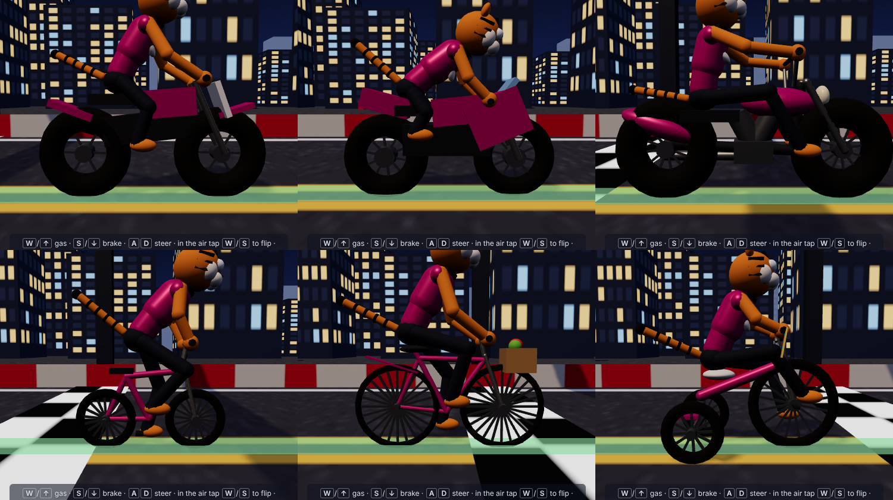

# RAMP RIOT

An animal stunt-bike racer with a built-in course editor. Pick a rider (fox, wolf, croc, tiger, panda or rhino), pick a bike, build a track out of jumps, loops, berms and obstacles, then race it.

## Play

The whole game is a single file, `index.html`. Open it in a browser, or serve the folder with any static host (GitHub Pages works: Settings → Pages → deploy from the `main` branch).

It loads Three.js from the jsDelivr CDN, so it needs an internet connection.

## Features

- Modes: race, stunt (score), drag (400 m), tour, and free ride
- Course builder with straights, turns, climbs, jumps, loops, berms, boost pads and whoops
- Scenery themes with a synth soundtrack
- Air tricks, wheelies, stunt replays and photo mode
- Ghosts, medals, high scores and a daily challenge
- Keyboard and gamepad on desktop; on phones and tablets a two-thumb trackpad by default (or buttons, tilt or swipe)
- In-game "How to play" guide and hands-on tutorial

## Ads

Ad slots are configured in the `ADS` object in `index.html`. Replace the placeholder AdSense client and slot ids with your own; ads only load when the file is self-hosted.

## Online races

When the game hub's lobby opens the game with `#hub=<hub>&room=<code>&token=<token>` in the URL, the game joins that room instead of the usual single-player flow:

- Every player rides their own bike; the others appear as see-through ghost riders with name tags, and on the progress bar and minimap.
- The race starts on the server's clock, and the finish time sent to the hub is measured on that clock. The hub rejects times shorter than the time that really passed, or shorter than `minMs` (70% of the course's par time, which is the gold medal time).
- The course is the host's course if they set one, otherwise Sunset Starter. Laps repeat the course end to end.
- Esc (pressed twice) retires. After the race, the results panel links back to the lobby, lets the host pick their current builder course for the next race, or drops back to single player.

Without that fragment nothing changes and the game makes no extra network calls. The game only loads hub code from origins listed in `HUB_ORIGINS` in `index.html` (the production and staging hubs, plus `localhost` for testing).
